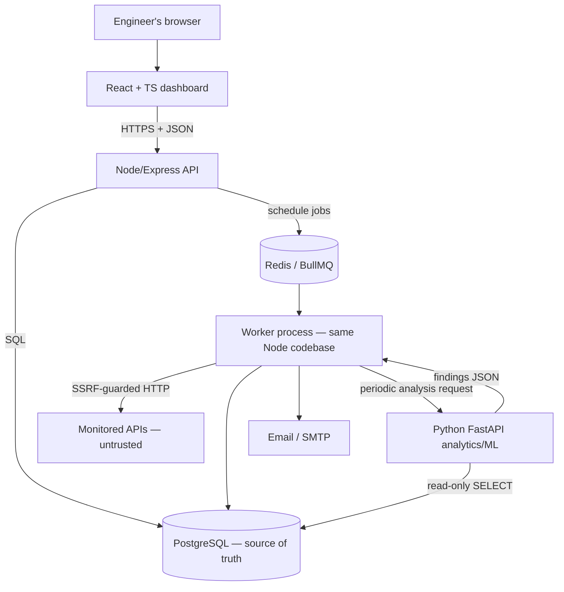
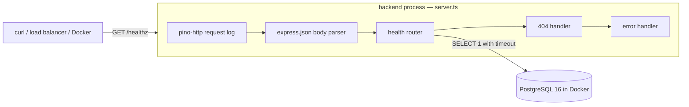
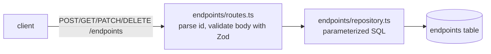
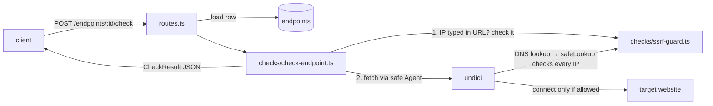
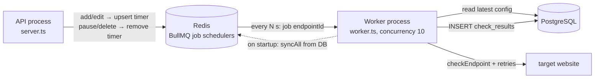
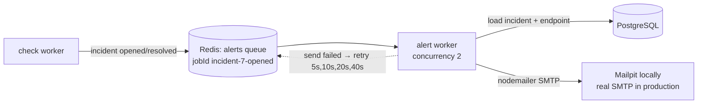
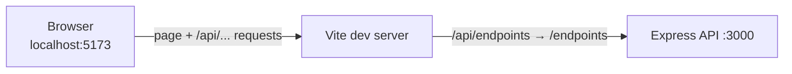
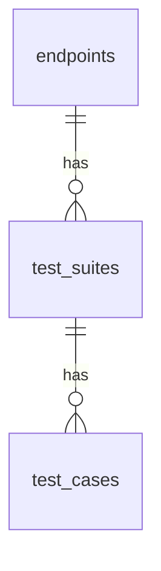
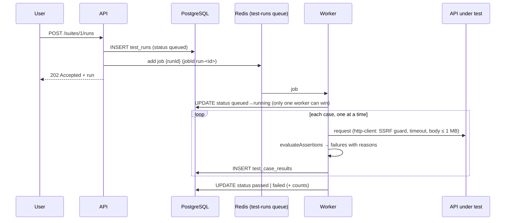
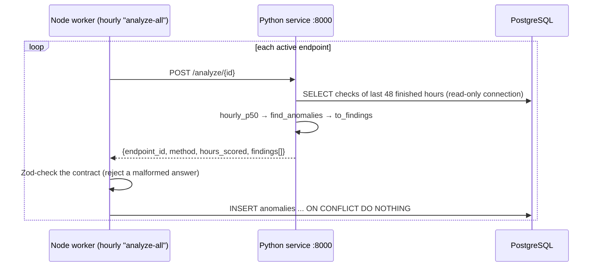

# Sentinel — Architecture

This document describes what **exists now** and what is **planned**. Planned parts are marked clearly.

## 1. Target architecture (planned)



Style: **modular monolith**. One Node.js codebase runs as an API process and (from M4) a worker process. Python is a separate service only because of the language/ecosystem boundary. See [DECISIONS.md](DECISIONS.md) ADR-001.

Principles:
- PostgreSQL is the durable source of truth; Redis only coordinates jobs.
- Measurements are persisted first; ML runs periodically over windows, never per check.
- Node owns the database schema (migrations). Python reads with a read-only role and returns findings for Node to validate and store (tentative; confirm in Phase 4).
- Every outbound request to a user-supplied URL goes through an SSRF guard (from M3).

## 2. Current state (Milestone 1)



### Backend modules

| File | Responsibility |
|---|---|
| `src/config.ts` | Read and validate environment variables once (Zod), fail fast, never print secret values |
| `src/logger.ts` | Structured JSON logger (pino) with header redaction |
| `src/db.ts` | PostgreSQL connection pool, `ping()` with timeout, idle-error handler, `withTimeout` helper |
| `src/middleware/errors.ts` | JSON 404 and a central error handler (4xx passthrough, generic 500) |
| `src/routes/health.ts` | `GET /healthz` readiness check |
| `src/app.ts` | Builds the Express app from injected dependencies (testable without a network or DB) |
| `src/server.ts` | Entry point: wires real dependencies, listens, graceful shutdown on SIGTERM/SIGINT |

### Request lifecycle: `GET /healthz`

1. `pino-http` records the start time and attaches a request logger.
2. `express.json` does nothing (no body).
3. The health router calls `db.ping(HEALTHCHECK_DB_TIMEOUT_MS)`, which races `SELECT 1` against a timer.
4. Success → `200 {"status":"ok",...}`. Any failure or timeout → logged at warn, `503 {"status":"error",...}`.
5. `pino-http` logs the completed request with status and response time.

### Failure behaviour

| Situation | Behaviour |
|---|---|
| Invalid/missing env var at startup | Prints which variables are wrong (not their values), exits with code 1 |
| Postgres down or slow | `/healthz` returns 503 within the timeout; process keeps running |
| Idle pooled connection dropped (Postgres restart) | Logged by `pool.on("error")`; process does not crash |
| Malformed JSON body | 400 `BAD_REQUEST` |
| Unknown route | 404 `NOT_FOUND` |
| Unexpected exception | Logged in full; client receives generic 500 `INTERNAL_ERROR` |
| SIGTERM / Ctrl+C | Stop accepting connections, finish in-flight requests, close pool, exit 0 (forced exit after 10 s) |

### API contract

```
GET /healthz
200 {"status":"ok","checks":{"database":"ok"}}
503 {"status":"error","checks":{"database":"error"}}
Headers: Cache-Control: no-store

Error shape (all endpoints):
{"error":{"code":"NOT_FOUND"|"BAD_REQUEST"|"INTERNAL_ERROR","message":"..."}}
```

## 3. Endpoint registry (Milestone 2)



Layers, each with one job:

| File | Job |
|---|---|
| `src/endpoints/schemas.ts` | What valid input is (Zod). Defaults live here only. |
| `src/endpoints/routes.ts` | HTTP: parse id, validate, call repository, choose status code |
| `src/endpoints/repository.ts` | SQL only; values always passed as `$1, $2...` parameters |
| `migrations/001_create_endpoints.sql` | Table definition with CHECK constraints as a second line of defence |
| `src/migrate.ts` | Applies pending `.sql` files in order inside a transaction; records them in `schema_migrations` |

### Schema: `endpoints`

| Column | Type | Notes |
|---|---|---|
| id | INTEGER identity PK | |
| name | TEXT | 1–100 chars |
| url | TEXT | ≤ 2048 chars; protocol checked by API |
| method | TEXT | `GET` / `HEAD` |
| interval_seconds | INTEGER | 30–3600 |
| timeout_ms | INTEGER | 1000–30000 (always < min interval) |
| expected_status | INTEGER | 100–599 |
| max_retries | INTEGER | 0–3 |
| paused | BOOLEAN | paused endpoints will not be scheduled (M4) |
| created_at / updated_at | TIMESTAMPTZ | stored in UTC; `updated_at` set by UPDATE |

Not yet: ownership (`user_id`), which comes with authentication. The URL is only checked *syntactically* here. The SSRF check (does it resolve to a private IP?) happens at request time in M3, because DNS answers can change after registration.

### Testing approach

- `health`, `config`, `errors`, `db` tests use fakes and need no database.
- `endpoints` and `migrate` tests are **integration tests** against a real `sentinel_test` database. `tests/global-setup.ts` creates and migrates it once, and each test truncates the table first. Test files run one at a time because they share that database.

## 4. Checking an endpoint (Milestone 3)



- `checkEndpoint()` **never throws**. Every outcome (up, wrong status, timeout, DNS failure, blocked) is returned as a `CheckResult`.
- Timeout: `AbortSignal.timeout(timeout_ms)` cancels the request.
- Response time = time until response headers arrive. The body is discarded.
- Redirects are **not followed** (`redirect: "manual"`). A 3xx is reported as the status.
- Since M4 step 1, "check now" saves each result to `check_results` (see below). Automatic scheduling is the next step.

### Schema: `check_results` (M4 step 1)

| Column | Type | Notes |
|---|---|---|
| id | INTEGER identity PK | |
| endpoint_id | INTEGER FK → endpoints(id) | `ON DELETE CASCADE`: deleting an endpoint deletes its history |
| ok | BOOLEAN | |
| status_code | INTEGER NULL | NULL when there was no answer |
| response_time_ms | INTEGER | |
| error_type / error_message | TEXT NULL | NULL when ok |
| checked_at | TIMESTAMPTZ | UTC |

Index `(endpoint_id, checked_at DESC)` makes "newest results for endpoint X" fast. API: `GET /endpoints/:id/checks?limit=N` (1–500, default 50).

Growth: one endpoint every 60 s produces about 1,440 rows/day (about 525k/year). A retention or cleanup job will be needed eventually; not yet.

### SSRF guard

Two checks, because there are two ways to reach an address:
1. **IP typed in the URL** (`http://127.0.0.1`): no DNS lookup happens, so `checkEndpoint` checks the IP itself.
2. **Hostname** (`http://localhost`): undici's Agent uses `safeLookup`, which does the normal DNS lookup and refuses if *any* returned IP is blocked. The check happens at connection time, so DNS changing its answer between check and connect (DNS rebinding) doesn't help an attacker.

Blocked ranges: 0/8, 10/8, 100.64/10, 127/8, 169.254/16, 172.16/12, 192.168/16, 224/4, 240/4, ::, ::1, fc00::/7, fe80::/10, ff00::/8. IPv4-mapped IPv6 (`::ffff:127.0.0.1`) is matched by the IPv4 rules automatically.

Known limits: the fetch standard refuses some ports outright ("bad port", reported as `network`). Private targets can't be monitored, which is by design. Tests pass `allowPrivateAddresses: true` so they can use a local fake server.

## 5. Automatic checks: Redis + BullMQ (Milestone 4)



- **One timer per endpoint**, with the fixed id `endpoint-<id>`. `upsertJobScheduler` updates it instead of creating duplicates.
- **Jobs carry only `endpointId`.** The worker reads the current URL, timeout and paused flag from Postgres for every job, so edits apply on the next tick.
- **Retries** (`max_retries`) happen inside one job, 1 s apart. Only the final result is saved.
- **A failed job** means our code broke (e.g. the DB is down), not that a site is down. It is logged and not retried: the next tick checks again.
- **Postgres is the source of truth.** Redis has no volume. `syncAll` on worker startup creates timers for active endpoints and removes timers for deleted/paused ones.
- Finished jobs are removed from Redis (`removeOnComplete`). Results live in Postgres.
- Redis keys use the prefix `sentinel`. Tests use `sentinel-test`.

Known limitation: if Redis is down when an endpoint is created or edited, the DB change succeeds but the request returns 500 and the timer isn't updated. Restarting the worker repairs it (`syncAll`).

## 6. Incidents (Milestone 5)

After every **scheduled** check, the worker runs `incidents/update-incidents.ts` (since M6, only the worker decides incidents; "check now" results are saved and counted at the next scheduled check). It applies one rule:

| Check | Open incident? | Action |
|---|---|---|
| ok | yes | resolve it (`resolved_at` = this check's time) |
| ok | no | nothing |
| failed | yes | nothing (still down) |
| failed | no | if the newest `failure_threshold` checks all failed → open one |

- `started_at` = time of the **first** failure in the streak (answers "when did it start?"). `error_type`/`error_message` come from that first failure.
- A partial unique index (`endpoint_id WHERE resolved_at IS NULL`) guarantees at most one open incident per endpoint, even if two workers race. Inserts use `ON CONFLICT ... DO NOTHING`.
- The rule returns `opened` / `resolved` / null. The worker logs it; M6 will send email on it.
- API: `GET /incidents?status=&endpoint_id=&limit=`, joined with the endpoint name.

### Schema: `incidents`

| Column | Type | Notes |
|---|---|---|
| id | INTEGER identity PK | |
| endpoint_id | INTEGER FK → endpoints | `ON DELETE CASCADE` |
| started_at | TIMESTAMPTZ | first failed check of the streak |
| resolved_at | TIMESTAMPTZ NULL | NULL = open |
| error_type / error_message | TEXT | from the first failed check |

`endpoints.failure_threshold` (1–10, default 3) was added in the same migration.

Known limitations: one success resolves an incident, so a "flapping" site (up/down/up) can open and close many incidents. Pausing an endpoint leaves an open incident open.

## 7. Email alerts (Milestone 6)



- Both workers run in the same `worker.ts` process.
- **Retries:** `attempts: 5`, exponential backoff from 5 s. A failed send throws, and BullMQ schedules the retry.
- **No duplicates:** the job id `incident-<id>-<kind>` is fixed, and finished jobs are kept for 24 h, so the same alert can't be queued twice.
- **Content:** `alerts/incident-email.ts` (pure function). Times are shown in UTC. The email states measured facts and explicitly says it doesn't know the cause.
- **Recipients:** global list `ALERT_EMAIL_TO`; empty = alerts off. Per-user preferences need authentication (later).
- The job carries only `incidentId` + `kind`. The worker reads current data from Postgres. If the incident was deleted, the alert is skipped.

## 8. Dashboard (Milestone 7)



| File | Job |
|---|---|
| `frontend/src/main.tsx` | Mounts React, defines page addresses (React Router) |
| `frontend/src/api.ts` | Typed `fetch` wrapper for every backend call; `ApiError` carries validation details |
| `frontend/src/usePolling.ts` | Hook: load now, then every 10 s |
| `frontend/src/status.ts` | Pure helpers: status word (up/down/failing/paused/pending), "5 min ago", local time |
| `frontend/src/pages/Overview.tsx` | Open incidents, websites table with Pause/Resume/Delete, add form |
| `frontend/src/components/AddEndpointForm.tsx` | Add-website form; shows the backend's validation messages |
| `frontend/src/pages/EndpointDetail.tsx` | `/endpoints/:id`: settings, Check now / Pause, summary of the last 50 checks, recent checks table, incident history |

| `frontend/src/components/StatsPanel.tsx` | 24h/7d/30d switch, cards (uptime with "X of N checks passed", P50/P95/P99, failures by type), chart, table view, metric definitions |
| `frontend/src/components/LatencyChart.tsx` | Recharts line chart of P50/P95 per bucket |

The detail page loads the endpoint, its last 50 checks and its incidents in parallel (`Promise.all`) in one polling cycle. `StatsPanel` polls `/stats` + `/timeseries` for the chosen range and ignores stale data from the previous range while switching.

**Chart rules applied:**
- Series colours are slots 1–2 of the reference data-viz palette (`#2a78d6` P50, `#eb6834` P95). Validated on the white card: colour-blind ΔE 24.7, both ≥ 3:1.
- 2px lines, 8px dots with a 2px white ring (so a lone bucket is visible), solid hairline grid, horizontal only.
- Legend plus end-of-line labels. All chart text uses text colours, not series colours.
- `connectNulls={false}`, so gaps show "no data". Animation off (it would replay every 10 s).
- A hover tooltip, plus a `<details>` table with every value, so nothing is hover-only.
- Light theme only (the app has no dark mode yet).

Production bundle is ~500+ kB, mostly Recharts. Accepted for now; code-split if load time matters.

- **One request for the table:** `GET /endpoints` includes each endpoint's `last_check` and `open_incident` (sub-queries with `row_to_json`), which avoids one request per row.
- **Status words:** `down` = an incident is open. `failing` = the last check failed but the threshold isn't reached yet. Facts first, no guessing.
- **Validation lives in the backend only.** The form shows the API's error messages.
- **Times:** the API sends UTC, and the browser shows local time.
- **Types are duplicated** in `api.ts` (not shared with the backend). It's simple, but they must be kept in sync by hand.
- No CORS needed in development thanks to the Vite proxy. A production deployment must serve the page and API from one origin (or add CORS): Phase 8.

## 9. Analytics (Phase 2)

### Step 1: `GET /endpoints/:id/stats?window=24h|7d|30d` (`src/analytics/stats.ts`)

Two SQL queries over `check_results` for one endpoint where `checked_at > now() - interval`. Both use the existing `(endpoint_id, checked_at DESC)` index:
1. A summary with `count(*)`, `count(*) FILTER (WHERE ok)`, and `percentile_disc(0.50/0.95/0.99) WITHIN GROUP (ORDER BY response_time_ms) FILTER (WHERE ok)`.
2. Failures `GROUP BY error_type`.

Exact metric definitions are in the README. Design points:
- `percentile_disc` (a real measured value) instead of `percentile_cont` (interpolated).
- Speed percentiles exclude failed checks, so timeouts don't masquerade as "slow responses".
### Step 2: `GET /endpoints/:id/timeseries` (`getEndpointTimeseries`)

One SQL query: `generate_series` makes every bucket start in the window, `date_bin(bucket, checked_at, '2000-01-01')` rounds each check down to its bucket, and a `LEFT JOIN` keeps empty buckets (0 checks, nulls) so charts show gaps honestly. Buckets: 1 h / 6 h / 1 day for 24h / 7d / 30d (25 / 29 / 31 points incl. partial ends), aligned to UTC. Daily buckets therefore split at UTC midnight, not local midnight (known limitation).

### Both

- Computed on request (no pre-aggregated tables). At about 1,440 rows/day/endpoint a 30-day window is about 43k rows per endpoint, which is fine for now. Revisit with roll-up tables if it becomes slow.

## 10. API testing (Phase 3)

### Step 1: suites and test cases (`src/testing/`)



- `test_suites(endpoint_id → endpoints, name)`: a suite belongs to one monitored endpoint, so later (Phase 7) test risk can use that endpoint's health.
- `test_cases(suite_id → test_suites, name, method, url, headers JSONB, body, timeout_ms, assertions JSONB)`. Both FKs use `ON DELETE CASCADE`.
- **No user code.** Assertions are a fixed menu, validated with a Zod `discriminatedUnion` on `type`: `status_equals`, `response_time_below_ms`, `header_contains`, `body_contains`, `json_path_exists`, `json_path_equals` (simple values only).
- **PATCH merges, then validates the whole case** with the create schema. That gives one set of rules, and cross-field rules (no body on GET/HEAD) still hold when only one field changes.
- JSONB parameters are `JSON.stringify`'d. The pg driver would otherwise send JS arrays as Postgres arrays (proved by a mutation check: 8 tests fail without it).
- Shared HTTP helpers (`parseId`, `sendValidationError`, `sendInvalidId`, `sendNotFound`) moved to `src/http.ts`.
- Known limitation: headers (e.g. auth tokens) are stored unencrypted.

### Step 2: running suites



- `src/checks/http-client.ts` (`sendRequest`) is the one safe request function, shared by health checks and API tests. `check-endpoint.ts` became a thin wrapper.
- `src/testing/assertions.ts` is a pure evaluator. JSON is parsed at most once; a dot path walks objects and arrays.
- **Idempotent start:** `UPDATE ... WHERE status = 'queued'` lets exactly one worker claim a run, so a duplicate job does nothing.
- If our code breaks mid-run, the run is marked `error` with the message (it doesn't stay `running`). A worker *crash* mid-run can still leave it `running` (known limitation).
- Jobs have `attempts: 1`: no automatic re-runs, because tests may have side effects (POST/DELETE).
- `test_case_results.case_id` uses `ON DELETE SET NULL` and keeps a copy of `case_name`, so history survives deleting a case.
- Worker concurrency for test runs: 2 suites at a time; cases within a suite run sequentially.

### Step 3: schedules + dashboard

- `test_suites.schedule_minutes` (5–1440 or NULL). The `test-runs` queue holds one BullMQ job scheduler per scheduled suite (`suite-<id>`), which emits `{ suiteId }` jobs. "Run now" jobs carry `{ runId }`. The worker handles both: `createScheduledRun` (skips deleted/empty suites) then `runSuite`.
- The API calls `schedule`/`unschedule` on create/PATCH/delete. The worker's startup `syncAll` rebuilds suite timers from Postgres (same pattern as endpoint timers).
- Suite PATCH = merge into the stored suite, then validate (`SuiteSettingsSchema`).
- Frontend: top nav (Websites / API tests). `/suites` lists suites with their last run and has a create form. `/suites/:id` has Run now, a schedule picker, run history, cases, and "add case" as pasted JSON (validated by the backend). `/suites/:id/runs/:runId` shows per-case PASS/FAIL with reasons. Pages poll every 3 s while runs progress.

### Known gap: nobody watches the worker

During development the worker process died (most likely while reloading a half-edited file). The API kept answering 200 on `/healthz`, but **no checks or runs happened for ~8 minutes and nothing reported it**: jobs simply waited in Redis. Mitigations for later: a process manager / Docker `restart: always` (Phase 8), and a worker heartbeat (e.g. "last check saved" age) exposed in `/healthz` and the dashboard.

## 11. Analytics service (Phase 4)

### Step 1: skeleton

- `analytics/`: Python 3.12, its own virtual environment (`.venv/`, git-ignored), dependencies pinned in `requirements.txt` (fastapi, uvicorn, pytest, httpx).
- `app/main.py`: FastAPI app with `GET /health`. FastAPI also serves auto-generated API docs at `/docs`.
- `tests/test_health.py`: pytest + FastAPI `TestClient` (in-memory requests, like Supertest).
### Step 2: anomaly logic (`analytics/app/anomaly.py`, pure functions)

- `hourly_p50(checks)`: raw checks → one value per hour = median response time of **successful** checks (`resample("1h").median()`). Hours without successful checks are NaN.
- `find_anomalies(values)`: for each hour, compare with the **previous** hours only (`shift(1)` + `rolling(24, min_periods=12)`):
  - baseline = rolling median
  - MAD = rolling median absolute deviation, floored at 1 ms
  - robust z = 0.6745 × (value − baseline) / MAD
  - flag if z > 3.5 (slower only)
  - NaN hours are dropped. With < 12 hours of history: no score, no flag.
- `to_findings(scored)`: flagged rows → dicts with time, value, baseline, score, severity (`critical` if z ≥ 10, else `warning`; a rule of thumb), and an explanation labelled "a statistical signal, not a diagnosis".
- Tested only on **made-up data** with known answers (11 pytest tests). Includes a demonstration that two earlier spikes hide a new spike from the classic mean/std z-score (≈3.3) but not from the robust score. Not yet evaluated on real data (too little history).

### Step 3: connected



- **One writer:** Python opens Postgres with `default_transaction_read_only=on`, so any write is refused by the database (tested). Node owns the schema and all writes.
- **Contract:** `AnalysisSchema` in `backend/src/analytics/anomalies.ts` mirrors the Python response. A broken answer is an error for that endpoint; nothing is saved.
- **Idempotent saving:** `UNIQUE (endpoint_id, metric, bucket_start, method)`. The 48 h lookback re-reports the same hours every run, and duplicates are skipped.
- **Failure isolation:** one endpoint failing (or Python down) is collected in `errors` and logged. The others continue, and the next hourly run retries.
- **Schedule:** a BullMQ job scheduler `analyze-all` on queue `analysis`, every hour (the first run is right away when the timer is created). Python is called **in batches**, never per check.
- `method` (`robust_z_v1`) is stored so a future ML detector's results can be compared side by side.
- Dashboard: "Unusual behaviour" section on the website page (value vs normal, score, severity, explanation, "signal, not diagnosis").
- Real data so far: each endpoint has only 3–5 hours of checks, so `hours_scored = 0` (the 12-hour minimum) and no anomalies yet. The detector is **not evaluated on real data**.

## 12. Local infrastructure

`docker-compose.yml` runs, all on `127.0.0.1` only:
- `postgres:16-alpine`: named volume `pgdata`, `pg_isready` healthcheck.
- `redis:7-alpine`: no volume (rebuilt from Postgres), `redis-cli ping` healthcheck.
- `axllent/mailpit:v1.33.1`: fake SMTP server on 1025, web inbox on http://localhost:8025.
