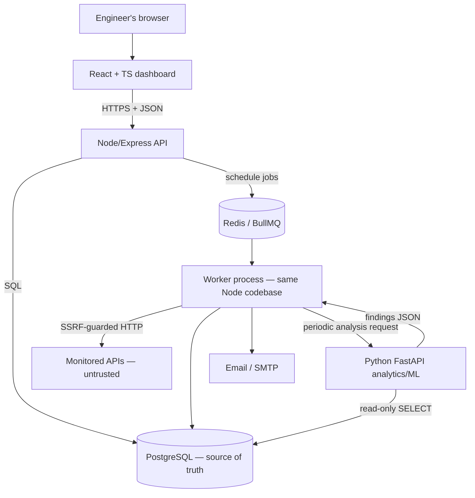
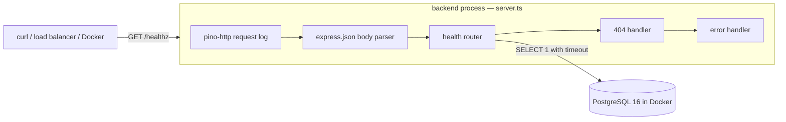
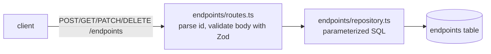
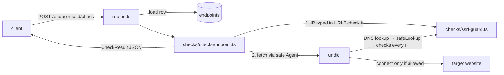

# Sentinel — Architecture

This document describes what **exists now** and what is **planned**. Planned parts are marked clearly.

## 1. Target architecture (planned)



Style: **modular monolith**. One Node.js codebase runs as an API process and (from M4) a worker process. Python is a separate service only because of the language/ecosystem boundary. See [DECISIONS.md](DECISIONS.md) ADR-001.

Principles:
- PostgreSQL is the durable source of truth; Redis only coordinates jobs.
- Measurements are persisted first; ML runs periodically over windows, never per check.
- Node owns the database schema (migrations). Python reads with a read-only role and returns findings for Node to validate and store (tentative; confirm in Phase 4).
- Every outbound request to a user-supplied URL goes through an SSRF guard (from M3).

## 2. Current state (Milestone 1)



### Backend modules

| File | Responsibility |
|---|---|
| `src/config.ts` | Read and validate environment variables once (Zod), fail fast, never print secret values |
| `src/logger.ts` | Structured JSON logger (pino) with header redaction |
| `src/db.ts` | PostgreSQL connection pool, `ping()` with timeout, idle-error handler, `withTimeout` helper |
| `src/middleware/errors.ts` | JSON 404 and a central error handler (4xx passthrough, generic 500) |
| `src/routes/health.ts` | `GET /healthz` readiness check |
| `src/app.ts` | Builds the Express app from injected dependencies (testable without a network or DB) |
| `src/server.ts` | Entry point: wires real dependencies, listens, graceful shutdown on SIGTERM/SIGINT |

### Request lifecycle: `GET /healthz`

1. `pino-http` records the start time and attaches a request logger.
2. `express.json` does nothing (no body).
3. The health router calls `db.ping(HEALTHCHECK_DB_TIMEOUT_MS)`, which races `SELECT 1` against a timer.
4. Success → `200 {"status":"ok",...}`. Any failure or timeout → logged at warn, `503 {"status":"error",...}`.
5. `pino-http` logs the completed request with status and response time.

### Failure behaviour

| Situation | Behaviour |
|---|---|
| Invalid/missing env var at startup | Prints which variables are wrong (not their values), exits with code 1 |
| Postgres down or slow | `/healthz` returns 503 within the timeout; process keeps running |
| Idle pooled connection dropped (Postgres restart) | Logged by `pool.on("error")`; process does not crash |
| Malformed JSON body | 400 `BAD_REQUEST` |
| Unknown route | 404 `NOT_FOUND` |
| Unexpected exception | Logged in full; client receives generic 500 `INTERNAL_ERROR` |
| SIGTERM / Ctrl+C | Stop accepting connections, finish in-flight requests, close pool, exit 0 (forced exit after 10 s) |

### API contract

```
GET /healthz
200 {"status":"ok","checks":{"database":"ok"}}
503 {"status":"error","checks":{"database":"error"}}
Headers: Cache-Control: no-store

Error shape (all endpoints):
{"error":{"code":"NOT_FOUND"|"BAD_REQUEST"|"INTERNAL_ERROR","message":"..."}}
```

## 3. Endpoint registry (Milestone 2)



Layers, each with one job:

| File | Job |
|---|---|
| `src/endpoints/schemas.ts` | What valid input is (Zod). Defaults live here only. |
| `src/endpoints/routes.ts` | HTTP: parse id, validate, call repository, choose status code |
| `src/endpoints/repository.ts` | SQL only; values always passed as `$1, $2...` parameters |
| `migrations/001_create_endpoints.sql` | Table definition with CHECK constraints as a second line of defence |
| `src/migrate.ts` | Applies pending `.sql` files in order inside a transaction; records them in `schema_migrations` |

### Schema: `endpoints`

| Column | Type | Notes |
|---|---|---|
| id | INTEGER identity PK | |
| name | TEXT | 1–100 chars |
| url | TEXT | ≤ 2048 chars; protocol checked by API |
| method | TEXT | `GET` / `HEAD` |
| interval_seconds | INTEGER | 30–3600 |
| timeout_ms | INTEGER | 1000–30000 (always < min interval) |
| expected_status | INTEGER | 100–599 |
| max_retries | INTEGER | 0–3 |
| paused | BOOLEAN | paused endpoints will not be scheduled (M4) |
| created_at / updated_at | TIMESTAMPTZ | stored in UTC; `updated_at` set by UPDATE |

Not yet: ownership (`user_id`), which comes with authentication. The URL is only checked *syntactically* here. The SSRF check (does it resolve to a private IP?) happens at request time in M3, because DNS answers can change after registration.

### Testing approach

- `health`, `config`, `errors`, `db` tests use fakes and need no database.
- `endpoints` and `migrate` tests are **integration tests** against a real `sentinel_test` database. `tests/global-setup.ts` creates and migrates it once, and each test truncates the table first. Test files run one at a time because they share that database.

## 4. Checking an endpoint (Milestone 3)



- `checkEndpoint()` **never throws**. Every outcome (up, wrong status, timeout, DNS failure, blocked) is returned as a `CheckResult`.
- Timeout: `AbortSignal.timeout(timeout_ms)` cancels the request.
- Response time = time until response headers arrive. The body is discarded.
- Redirects are **not followed** (`redirect: "manual"`). A 3xx is reported as the status.
- Results are returned only, not stored. Storage and scheduling come in M4.

### SSRF guard

Two checks, because there are two ways to reach an address:
1. **IP typed in the URL** (`http://127.0.0.1`): no DNS lookup happens, so `checkEndpoint` checks the IP itself.
2. **Hostname** (`http://localhost`): undici's Agent uses `safeLookup`, which does the normal DNS lookup and refuses if *any* returned IP is blocked. The check happens at connection time, so DNS changing its answer between check and connect (DNS rebinding) doesn't help an attacker.

Blocked ranges: 0/8, 10/8, 100.64/10, 127/8, 169.254/16, 172.16/12, 192.168/16, 224/4, 240/4, ::, ::1, fc00::/7, fe80::/10, ff00::/8. IPv4-mapped IPv6 (`::ffff:127.0.0.1`) is matched by the IPv4 rules automatically.

Known limits: the fetch standard refuses some ports outright ("bad port", reported as `network`). Private targets can't be monitored, which is by design. Tests pass `allowPrivateAddresses: true` so they can use a local fake server.

## 5. Local infrastructure

`docker-compose.yml` runs `postgres:16-alpine`, published on `127.0.0.1:5432` only (not reachable from the network), with data in the named volume `pgdata` and a `pg_isready` healthcheck. Redis is added in M4 when job scheduling needs it.
