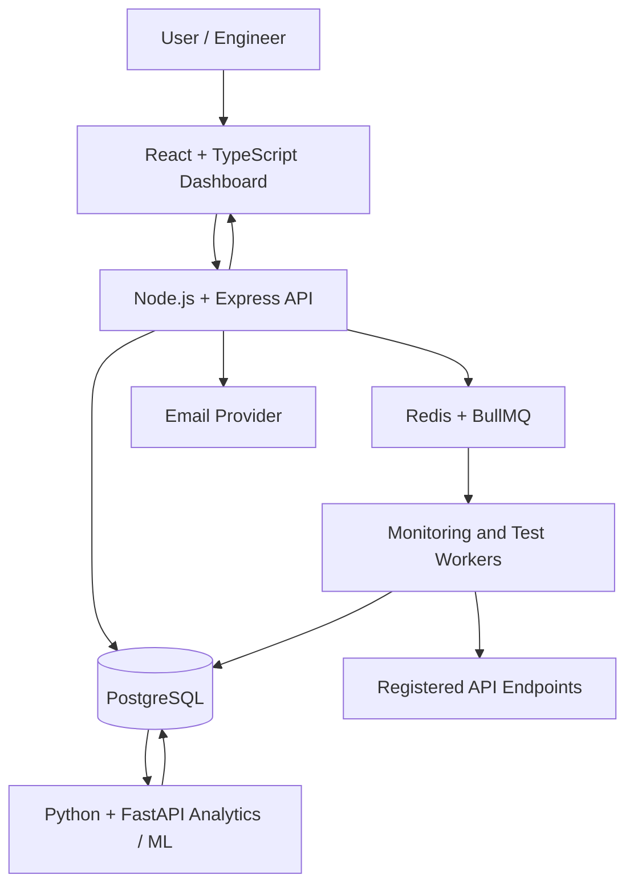

# Sentinel — Project Blueprint

## 1. Product overview

**Name:** Sentinel — AI-Powered Observability & Intelligent Test Automation Platform

**One-line description:** An intelligent platform that monitors APIs, automates validation, detects abnormal system behavior, helps investigate incidents, predicts degradation when supported by historical data, and prioritizes tests based on risk.

### Problem
Traditional uptime monitors often tell an engineer that an endpoint is failing or slow, but provide limited help with historical patterns, validation, anomaly detection, failure investigation, or deciding which tests to run first.

### Product goals
1. Monitor API availability and performance reliably.
2. Preserve useful historical measurements and incidents.
3. Validate API behavior through automated tests.
4. Detect unusual behavior using transparent statistical and ML methods.
5. Investigate and classify failures using logs and supporting evidence.
6. Prioritize tests based on explainable risk signals.
7. Present the system's health and findings in one dashboard.

### Non-goals for the initial version
- Real RF hardware testing.
- Real cellular PHY/baseband validation.
- Unrestricted execution of user-submitted code.
- A large microservices platform.
- Claims of guaranteed root-cause detection or guaranteed failure prediction.

## 2. Core modules

### Module 1 — Endpoint management and monitoring
- Endpoint CRUD and ownership.
- Configurable check interval, timeout, expected status, and retry policy.
- Scheduled HTTP requests.
- Persisted check result: endpoint, timestamp, status, latency, outcome, error category.
- Uptime/downtime calculations.
- SSL certificate expiry checks where feasible.
- Incident creation, recovery, timeline, and notifications.
- Public status page with privacy controls.

### Module 2 — Observability analytics
- Latency history and P50/P95/P99.
- Availability and error-rate trends.
- Endpoint comparisons.
- Incident timelines.
- Explicit aggregation windows and metric definitions.

### Module 3 — Automated API testing
- Suites and test cases.
- Status/header/body/schema assertions.
- Auth and negative-path tests.
- Latency assertions.
- Scheduled execution and history.
- Bounded concurrency/load tests.
- Pytest-based runner where suitable.

### Module 4 — Anomaly detection
- Statistical baseline first.
- Moving averages and Z-score/robust alternatives.
- Isolation Forest or other ML method only after a baseline and evaluation.
- Store anomaly evidence, score, severity, and baseline comparison.
- Track false positives and missed events.

### Module 5 — Predictive failure analysis
- Define target, features, and prediction horizon.
- Build baseline model.
- Use time-aware data splits to prevent leakage.
- Evaluate with suitable metrics.
- Display only validated predictions and limitations.

### Module 6 — Failure classification and investigation
- Normalize and categorize check errors and logs.
- Group recurring patterns.
- Correlate incidents and anomalies when supported.
- NLP-based classification and optional LLM summaries.
- Evidence-backed summaries and suggested next steps.

### Module 7 — Intelligent test prioritization
- Use recent failures, endpoint risk, historical test failures, and recency.
- Generate an explainable priority score.
- Show why each test ranks where it does.
- Compare prioritized run against full-suite run.
- Preserve full-suite mode; do not silently skip tests.

### Module 8 — Dashboard and reports
- Service health overview.
- Endpoint details and metric charts.
- Incident and anomaly views.
- Test suite and execution history.
- Prediction and investigation views.
- Email notifications and public status pages.

## 3. Proposed architecture

### Component responsibilities

**React frontend**
- Dashboard, endpoint management, test configuration, charts, incident views.

**Node.js/Express application backend**
- Application APIs, authentication, validation, authorization, endpoint configuration, orchestration, and business workflows.

**BullMQ workers**
- Scheduled health checks, retries, test-suite scheduling, notifications, and periodic analysis triggers.

**Redis**
- Queue and scheduling coordination. Not the durable source of business history.

**PostgreSQL**
- Users, endpoints, check results, incidents, test suites, test runs, anomaly records, predictions, and investigation reports.

**Python/FastAPI analytics service**
- Aggregation and feature preparation, anomaly detection, predictive experiments/inference, and failure classification.

**External endpoints**
- The systems Sentinel monitors. They must be treated as untrusted network destinations.

## 4. Important data flow

### Health-check flow
1. User registers an endpoint and check configuration.
2. Backend validates and stores the endpoint.
3. Scheduler queues a health-check job.
4. Worker performs a bounded HTTP request.
5. Worker records status, latency, timestamp, and error details.
6. Incident rules determine whether an incident starts, continues, or resolves.
7. Alerts are sent when configured.
8. Aggregated metrics become available to the dashboard and analytics service.

### Analytics flow
1. Measurements accumulate in PostgreSQL.
2. A scheduled job selects a defined time window.
3. Analytics service calculates baselines/features.
4. Detection or prediction runs.
5. Results and supporting evidence are persisted.
6. Dashboard displays findings with clear labels and limitations.

### Test-execution flow
1. User defines a suite and assertions.
2. Backend validates and schedules execution.
3. Worker executes bounded test cases.
4. Assertions produce pass/fail results and diagnostics.
5. Results are persisted and shown in test history.
6. Prioritization logic uses history and risk signals to recommend execution order.

## 5. Technology direction

| Layer | Initial choice |
|---|---|
| Frontend | React + TypeScript |
| Main backend | Node.js + Express |
| Database | PostgreSQL |
| Background jobs | Redis + BullMQ |
| Analytics/ML | Python + FastAPI |
| Data processing | Pandas + NumPy |
| ML | scikit-learn |
| Testing | Pytest plus backend integration tests |
| Local environment | Docker Compose |
| CI | GitHub Actions |

These are proposed choices. Review the existing repository and explain any changes before adopting them.

## 6. Roadmap

### Phase 0 — Repository and design discovery
> **Status (2026-11-11): done.** Inspection found no existing code (docs only), so there was no prior API monitor to preserve. Stack confirmed as proposed, with a TypeScript backend and Docker Compose for local dependencies (see `docs/DECISIONS.md` ADR-001–004). Runnable baseline = Milestone 1 walking skeleton (`GET /healthz`).
>
> **Phase 1 milestone breakdown:** M1 walking skeleton ✅ → M2 endpoint registry (migrations + CRUD) ✅ → M3 single-check executor with SSRF guard ✅ → M4 persisted results + BullMQ scheduling/worker ✅ → M5 incident lifecycle ✅ → M6 email alerts ✅ → M7 minimal dashboard ✅ (overview + detail page). **Phase 1 complete.** Next: Phase 2 historical analytics.

- Inspect current repo and existing API monitor.
- Record what works and what needs improvement.
- Draw current and target architecture.
- Agree on stack and initial milestones.
- Create a runnable baseline and Git checkpoint.

### Phase 1 — Reliable monitoring foundation
- Endpoint management.
- Scheduling and worker execution.
- Timeout/retry behavior.
- Persist check results.
- Incident lifecycle and email alerts.
- Basic dashboard and endpoint detail page.
- Tests and security checks, especially SSRF protection.

### Phase 2 — Historical analytics
> **Status (2026-11-11):** stats API (uptime %, P50/P95/P99, failures by type over 24h/7d/30d), time-series API, and the detail-page performance panel with chart ✅. Metric definitions are in the README. Endpoint comparisons and an incident timeline view are not built yet.

- Uptime calculations.
- Latency charts and percentiles.
- Error rates and incident timelines.
- Define aggregation windows and test calculations.

### Phase 3 — Automated API testing
> **Status (2026-11-11):** ✅ suites + test cases (declarative, ADR-012), runner (queue + worker, per-case results with reasons), schedules, and dashboard pages. Not built: bounded concurrency/load tests (deferred), JSON-schema assertion, multi-step flows.

- Suites and test cases.
- Assertions and validation.
- Execution history and reports.
- Safe concurrency limits.
- Scheduling and tests.

### Phase 4 — Python analytics foundation
> **Status (2026-11-11):** step 1 ✅ Python project skeleton (venv, FastAPI `/health`, pytest). Step 2 ✅ anomaly logic with Pandas (hourly P50 + robust z-score vs previous 24 h), tested on made-up data. Next: step 3, connect to Postgres + Node + dashboard.

- Python project structure and FastAPI basics.
- Data retrieval/contract with Node backend.
- Pandas/NumPy feature preparation.
- Statistical anomaly baseline.
- Evaluate and visualize results.

### Phase 5 — ML anomaly detection and predictive experiments
- Compare statistical baseline with Isolation Forest.
- Define predictive target and horizon.
- Train/test using time-aware splits.
- Evaluate honestly and persist results.

### Phase 6 — Failure classification and incident assistance
- Error normalization.
- Rule-based categories.
- TF-IDF/classification experiment.
- Evidence-backed incident summary.
- Optional LLM integration with safeguards.

### Phase 7 — Intelligent test prioritization
- Define risk signals and scoring.
- Rank tests with explanations.
- Compare time and outcomes against full-suite mode.

### Phase 8 — Polish and delivery
- Dashboard refinements.
- Security review.
- Tests and CI.
- Docker Compose deployment.
- README, architecture diagrams, demo data, and project walkthrough.

## 7. System design topics to learn

Learn these as they become relevant:
- HTTP request lifecycle, status codes, TLS, DNS.
- Latency, percentiles, uptime, error rates.
- Polling vs event-driven architecture.
- Job queues, workers, retries, exponential backoff, idempotency.
- Database schema design, indexing, migrations, time-series data.
- API design, validation, authentication, authorization.
- SSRF and safe outbound HTTP requests.
- Testing pyramid, integration tests, contract tests, load tests.
- Metrics, logs, traces, observability.
- Statistics, baselines, anomaly detection, classification, regression.
- Feature engineering, data leakage, time-series validation, model evaluation.
- NLP, TF-IDF, embeddings, LLM grounding.
- CI/CD, Docker, deployment, secrets, monitoring the monitor.

## 8. Key product and engineering decisions to record

For every significant decision, document:
- Context/problem.
- Options considered.
- Chosen option.
- Why it was selected.
- Trade-offs and limitations.
- What evidence would make us revisit it.

Do not silently change scope or architecture.
